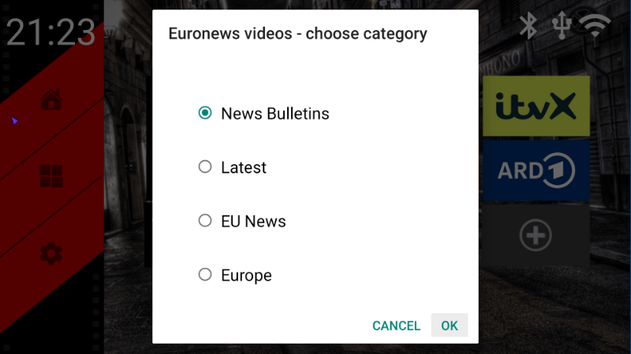
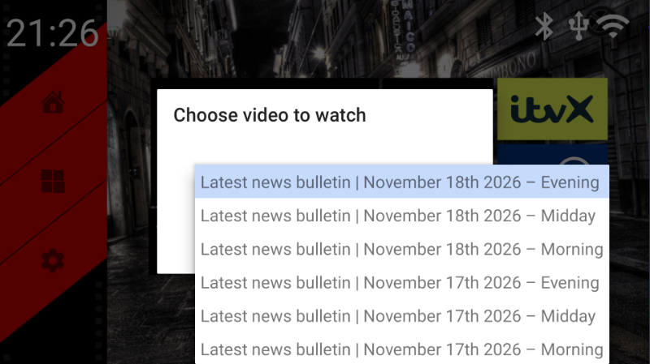

# euronews-viewer

If the Euronews app isn't working for you, you may find this [Termux](https://f-droid.org/en/packages/com.termux/) script useful.

_Kindly use the app if it works on your device - the only reason for development of this script was inability to watch Euronews, other than in a browser, which is inconvenient using an IR remote._
|                  ​​​​​​​                                    |                                                    |
| :--------------------------------------------------: | :------------------------------------------------: |
|  |   |


## Dependencies

[Termux](https://f-droid.org/en/packages/com.termux/)</br>
[Termux:API](https://f-droid.org/en/packages/com.termux.api/)</br>

In Termux:
```
$ pkg install termux-api libxml2-utils jq w3m
```
Optional:

[Termux:Widget](https://f-droid.org/en/packages/com.termux.widget/) - to add a homescreen shortcut</br>
[TermuxRunner](https://github.com/mycir/TermuxRunner/) - to launch from a TV or TV Box</br>

## Installation

Termux preparations, if not already done:

[Sharing Data (termux-setup-storage and allow-external-apps).](https://wiki.termux.com/wiki/Sharing_Data)</br>
[Termux:Widget - Setup Instructions](https://github.com/termux/termux-widget#setup-instructions)</br>

```
$ cp <path, e.g. ~/storage/downloads>/euronews-viewer ~/.shortcuts/tasks
$ cp <path, e.g. ~/storage/downloads>/euronews-viewer.png ~/.shortcuts/icons
$ chmod 700 ~/.shortcuts/tasks/euronews-viewer
$ chmod 600 ~/.shortcuts/icons/euronews-viewer.png
```
Android >= 10

Settings > Apps > 3 dots > Allow Resricted settings</br>
Settings > Apps > Termux > Advanced > Display over other apps</br>
...or similar, according to Android version.

## Modifications

If there's an excessive delay before the video selection dialog is shown, try a lower MAX_ITEMS .

If mpv-android is your default player, it will not autoplay on subsequent executions of this script and you will need to tap/click/key its play button. Possible solution requiring root:
```
su -c "dumpsys activity recents | grep -B3 is.xyz.mpv | grep -oE 'StackId=[0-9]+' | \
   head -1 | cut -d= -f2 | xargs am stack remove" 2>/dev/null
su -c "am force-stop is.xyz.mpv"
termux-open --content-type video/mp4 $mp4_url
```
## Caveats

Does not aim to present every one of the many Euronews videos for viewing, just the most recent under top level nav bar categories.

May break if the Euronews website is redesigned, or they change to 3rd party hosting with cookies and tokens. (Will try to maintain but no promises.)

